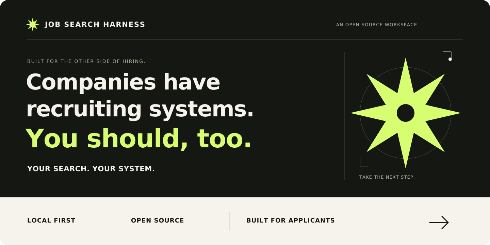
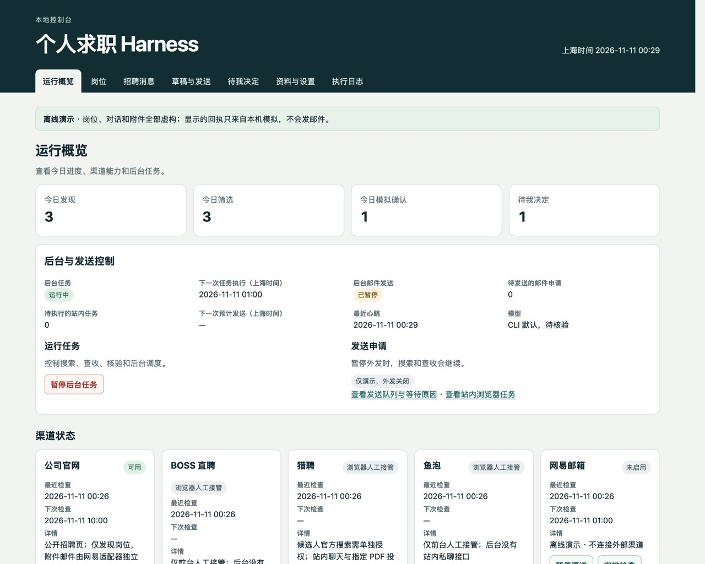
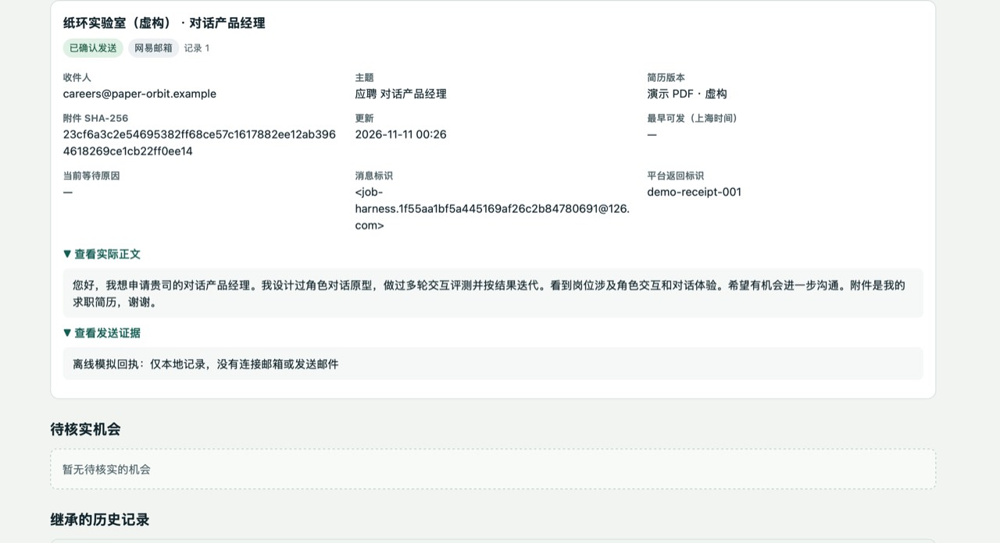

<p align="center">
  
</p>

<p align="center">Listings. Résumés. Applications. Recruiter conversations.<br><strong>One workspace to pick up where you left off.</strong></p>

<p align="center">
  <a href="#quickstart"><strong>▶ Try the demo</strong></a>　·　
  <a href="#ai-install"><strong>✦ Let your coding assistant install it</strong></a>　·　
  <a href="README.md">中文</a>　·　
  <a href="https://github.com/milkrabbitt/job-search-harness/releases/tag/v0.1.0">v0.1.0 preview</a>
</p>

<p align="center">
  <a href="https://github.com/milkrabbitt/job-search-harness/actions/workflows/tests.yml"></a>
  <a href="LICENSE"></a>
  
</p>

## Your next job shouldn't get lost in your tabs.

You save a listing. Send a résumé. Get a reply. Then spend the next session piecing together what happened.

**The search is hard enough. Remembering its status shouldn't be another job.**

Job Search Harness is an open-source workspace that runs on your computer. Keep job sources, match evidence, application materials, recruiter conversations and next actions together.

| Is this role worth pursuing? | What did I actually send? | What needs my attention? |
| :--- | :--- | :--- |
| Review match reasons, gaps and unknowns. Merge duplicate listings. | Check the draft, recipient, approved PDF and sending evidence. | Pick up recruiter conversations and review pending decisions. |



<p align="center"><sub>Real running product · Fictional demo data · Simulated receipts</sub></p>

<a name="quickstart"></a>

## Run the demo before connecting anything.

**No real résumé, email credentials or model account needed.** Requires macOS / Linux, Python 3.9+, SQLite 3.24+ and IANA timezone data. The default runtime uses the Python standard library; no frontend build is required. The current console is in Chinese.

```sh
git clone https://github.com/milkrabbitt/job-search-harness.git
cd job-search-harness
./scripts/doctor.sh
./scripts/bootstrap.sh --demo
./scripts/serve.sh
```

Open **http://127.0.0.1:8876/**. Press **Ctrl+C** to stop. Demo data is stored in `.job-harness-dev/`.

<a name="ai-install"></a>

### Prefer your coding assistant to handle setup?

```text
Install and verify Job Search Harness on my computer:
https://github.com/milkrabbitt/job-search-harness

Read README.en.md, docs/install.en.md and job_harness/CHANNELS.md first.
Check OS support. Use a separate directory and Python virtual environment.
Start the offline demo; verify job matches, applications, recruiter messages
and pending decisions. Run the project tests.
Keep real accounts and outbound sending disabled. Leave my existing data alone.
Give me the local URL, start/stop commands and data location.
If I want live channels or model integration, explain support and guide me
through local authentication. Never ask me to paste secrets into chat.
```

Use a terminal-capable coding assistant such as Codex, Claude Code or Cursor Agent. The installer assistant and runtime model are separate: the optional match review currently uses a locally authenticated Codex CLI.

[Full installation guide →](docs/install.en.md) · [Channel requirements →](job_harness/CHANNELS.md) · [Troubleshooting →](docs/troubleshooting.md)

## An application you can trace, not just remember.

### 01 / Understand the opportunity

Keep duplicate listings from becoming duplicate work. See the original source, match reasons, explicit gaps and unanswered questions together. **The score orders opportunities; the evidence helps you decide.**


### 02 / Know what went out

Keep the draft, recipient, approved résumé and receipt together. An uncertain email result is reconciled against its original Message-ID. Submit platform applications in your browser and record the evidence. **Prepared and sent are separate states.**



### 03 / Pick up where you left off

Read the recruiter thread alongside its job and pending decisions. Keep interview arrangements visible until you decide. **Let the workspace hold the context. Keep the decisions yours.**


## Why a harness?

A chat ends. Your job search doesn't. Persistent records, task states and verification steps carry the work into the next session.

- **Runs locally.** Python, SQLite, a loopback console, backups and recovery.
- **Progress you can inspect.** Separate task and outbound controls; duplicate checks, stale-draft checks and uncertain-send handling.
- **AI with a specific role.** Optional match review; authorization and sending remain controlled by the workbench.
- **Yours to extend.** MIT-licensed source you can adapt to your search.

## Use your own data and accounts

Choose a separate private data directory and omit `--demo` when initializing. Use 「资料与设置」 (Profile and settings) to set preferences, add verified public job sources, and manage personal facts and approved résumé versions. The [configuration template](examples/config.example.json) and [fictional profile](examples/profile.example.json) show the expected formats.

The built-in matching preset focuses on Chinese JDs for AI applications, product, robotics, and financial products. Set your own cities, role terms, salary floor, exclusions, and sending rules. Work arrangement and employment type notes are for manual review. Other industries can still be tracked manually.

| Channel | What is available |
| --- | --- |
| Company websites | Read registered, accessible public job sources. Submit official application forms on the original site. |
| NetEase 126 Mail | On macOS with Keychain configured, check recruiting email, prepare threaded replies, and send and verify authorized mail. |
| Liepin | With candidate authorization configured, search for jobs and check public details. Chat and submissions use browser handoff. |
| BOSS Zhipin and Yupao | Queue and deduplicate platform actions, then record evidence. Complete the action in your logged-in browser. |
| Optional runtime model | A local Codex CLI can review a limited set of match features. The workbench controls authorization and sending. |

See the [channel setup and dependency guide](job_harness/CHANNELS.md) for credentials and troubleshooting. Enable real outbound sending after verifying your account, authorization, and application materials.

<a name="troubleshooting"></a>

## Troubleshooting

[Full diagnostics, service management and backup instructions](docs/troubleshooting.md).

- **Port in use.** If the same instance is already running, open its console. To run a second instance, use a separate data directory and set a free port in its `config.json`.
- **Missing timezone data.** Install your system’s `tzdata` package or run `python -m pip install tzdata` inside the chosen virtual environment.
- **Authorization or access problem.** Check the channel status and error on the dashboard. Complete any login or verification on the provider’s site and check your local configuration against the [channel setup and dependency guide](job_harness/CHANNELS.md).

## Running, privacy, and backups

- **Runs locally.** The console listens on the loopback address. On macOS, the `install` subcommand installs a LaunchAgent for the current user, which can be managed with `start`, `status`, and `stop`. Linux supports foreground operation. Tasks pause when the computer sleeps or shuts down.
- **Separate controls for tasks and outbound sending.** Pause outbound actions while job discovery and inbox checks continue. Pause background tasks to stop scheduling.
- **Private data stays under your control.** Keep SQLite data, résumés, and backups outside the repository. Real channel credentials are stored in the system Keychain. Any enabled external channel receives the material you send through it.
- **Optional model calls.** Enabling Codex review sends a limited set of structured matching features to its model service. A local workspace does not mean local model inference.
- **Back up and restore.** Back up from the console or run `python3 -B -m job_harness --data-dir "$JOB_HARNESS_DATA_DIR" backup`. Stop the instance before running `restore /path/to/backup.sqlite3` with the same data directory. Check sending evidence before resuming outbound actions after a restore.

<a name="tests"></a>

## Tests

The current suite contains **75 tests** covering matching, deduplication, stale drafts, attachment checks, pause controls, and sending recovery with temporary databases, fictional data, and simulated channels.

```sh
python3 -B -m unittest discover -s tests -v
```

## Better tools on the applicant’s side.

**If that is a future you want, give the project a Star.**

Try the demo, then tell us which part of your search needs less busywork. [Share feedback](https://github.com/milkrabbitt/job-search-harness/issues), improve the docs or contribute code. Use fictional data in reports.

[↑ Try the demo](#quickstart) · [Copy the installation prompt](#ai-install)

Released under the [MIT license](LICENSE).

