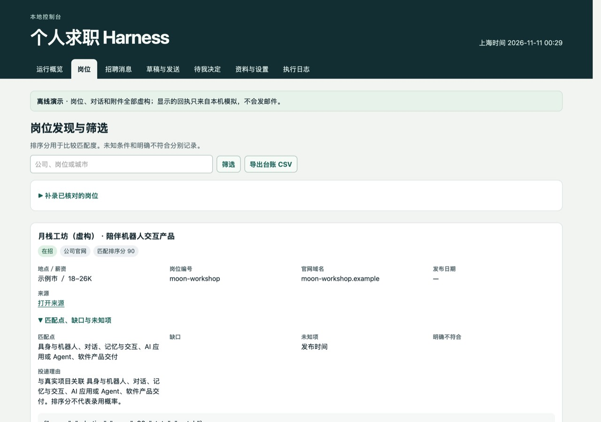

# Job Search Harness

Job Search Harness is a local workspace for finding roles, screening job descriptions against your preferences, preparing applications, and following up on recruiter messages. The web console is in Chinese.

[Run the demo](#quickstart) · [AI installation prompt](#ai-install) · [中文](README.md) · [Tests](#tests) · [MIT](LICENSE) · [v0.1.0 beta](https://github.com/milkrabbitt/job-search-harness/releases/tag/v0.1.0)

## How the workflow works

1. **Set up your profile.** Add verified personal facts, a local résumé PDF you have approved for use, and preferences such as cities, role types, and an optional salary floor. You register the PDF yourself; Harness does not extract your work history from it.
2. **Find and screen jobs.** Search configured public company sources and authorized Liepin listings, or add job descriptions by hand. Matching rules explain the fit, gaps, and missing information. An optional Codex CLI review can add notes.
3. **Send an application.** Check the recipient, message, and attachment. With NetEase 126 configured, Harness can send approved applications. Submit official forms and platform messages in the original browser, then record the verified result.
4. **Follow up.** Read synced email and recorded platform conversations with their related jobs. Harness can send a narrow set of preauthorized replies to verified email threads. Interview scheduling, salary decisions, and offers stay in the decision queue for you.
5. **Review the record.** Check application status, evidence, and communication history. View the salary range recorded for each role and export the application ledger to CSV for your own comparisons. Unlisted pay stays unknown, and Harness does not compare full offer packages.



*The offline demo uses fictional job listings and simulated sending.*

<a name="ai-install"></a>

## Let an AI assistant install it

[Copy the installation prompt](docs/install.en.md#ai-install) into Codex, Claude Code, or Cursor Agent. Your installation assistant sets up the project; the optional runtime integration uses a locally authenticated Codex CLI to review a limited set of job match features. The demo needs only local Python.

<a name="quickstart"></a>

## Try it now

Requires macOS or Linux, Python 3.9+, SQLite 3.24+, and IANA timezone data for `Asia/Shanghai`. The current console is in Chinese. The default runtime uses the Python standard library.

```sh
git clone https://github.com/milkrabbitt/job-search-harness.git
cd job-search-harness
./scripts/doctor.sh
./scripts/bootstrap.sh --demo
./scripts/serve.sh
```

Open the address printed in your terminal, usually `http://127.0.0.1:8876/`. Closing the browser tab leaves the service running. Press **Ctrl+C** in the terminal to stop the foreground process. The default data directory is `.job-harness-dev/`. To use a different directory, set the same `JOB_HARNESS_DATA_DIR` for bootstrap and serve. See [troubleshooting](#troubleshooting) if a port is occupied or a dependency is missing.

## What to look for in the demo

- Open 「岗位」 (Jobs) to inspect the source link, salary range when listed, match reasons, and gaps in the job description.
- Open 「草稿与发送」 (Drafts and sending) to review a fictional application, its approved résumé, and the simulated send receipt. With real email configured, uncertain sends stay pending verification by Message-ID.
- Open a thread under 「招聘消息」 (Recruiter messages), then look in 「待我决定」 (Decisions) for the interview scheduling request.

## Use your own data and accounts

Choose a separate private data directory and omit `--demo` when initializing. Use 「资料与设置」 (Profile and settings) to set preferences and add verified public job sources. To add personal facts and register an approved local PDF, follow the [fictional profile](examples/profile.example.json) and import your own private JSON with `python3 -B -m job_harness --data-dir "$JOB_HARNESS_DATA_DIR" init --inheritance /path/to/profile.json`. In the private JSON, add each approved résumé under `resumes` with `path`, `label`, `scope`, `sha256`, and `approved: true`. The SHA-256 value must match the local PDF before it can be used. See the [configuration template](examples/config.example.json) for channel settings.

The built-in matching preset focuses on Chinese JDs for AI applications, product, robotics, and financial products. Set your own cities, role terms, salary floor, exclusions, and sending rules. Work arrangement and employment type notes are for manual review. Other industries can still be tracked manually.

| Channel | What is available |
| --- | --- |
| Company websites | Read registered, accessible public job sources. Submit official application forms on the original site. |
| NetEase 126 Mail | On macOS with Keychain configured, check recruiting email, prepare threaded replies, send approved applications, and verify sending. With automatic sending enabled, eligible requests for a résumé, public portfolio, or a brief answer based on a verified fact can receive a reply in a trusted thread. |
| Liepin | With candidate authorization configured, search for jobs and check public details. Chat and submissions use browser handoff. |
| BOSS Zhipin and Yupao | Queue and deduplicate platform actions, then record evidence. Complete the action in your logged-in browser. |
| Optional runtime model | A local Codex CLI can review a limited set of match features. The workbench controls authorization and sending. |

See the [channel setup and dependency guide](job_harness/CHANNELS.md) for credentials and troubleshooting. Enable real outbound sending after verifying your account, authorization, and application materials.

<a name="troubleshooting"></a>

## Troubleshooting

[Full diagnostics, service management and backup instructions](docs/troubleshooting.md).

- **Port in use.** If the same instance is already running, open its console. To run a second instance, use a separate data directory and set a free port in its `config.json`.
- **Missing timezone data.** Install your system’s `tzdata` package or run `python -m pip install tzdata` inside the chosen virtual environment.
- **Authorization or access problem.** Check the channel status and error on the dashboard. Complete any login or verification on the provider’s site and check your local configuration against the [channel setup and dependency guide](job_harness/CHANNELS.md).

## Running, privacy, and backups

- **Runs locally.** The console listens on the loopback address. On macOS, the `install` subcommand installs a LaunchAgent for the current user, which can be managed with `start`, `status`, and `stop`. Linux supports foreground operation. Tasks pause when the computer sleeps or shuts down.
- **Separate controls for tasks and outbound sending.** Pause outbound actions while job discovery and inbox checks continue. Pause background tasks to stop scheduling.
- **Private data stays under your control.** Keep SQLite data, résumés, and backups outside the repository. Real channel credentials are stored in the system Keychain. Any enabled external channel receives the material you send through it.
- **Back up and restore.** Back up from the console or run `python3 -B -m job_harness --data-dir "$JOB_HARNESS_DATA_DIR" backup`. Stop the instance before running `restore /path/to/backup.sqlite3` with the same data directory. Check sending evidence before resuming outbound actions after a restore.

<a name="tests"></a>

## Tests

Local tests exercise matching, deduplication, stale drafts, attachment checks, pause controls, and sending recovery with temporary databases, fictional data, and simulated channels.

```sh
python3 -B -m unittest discover -s tests -v
```

To report a bug or suggest an improvement, [open an issue](https://github.com/milkrabbitt/job-search-harness/issues) with a fictional example.

Released under the [MIT license](LICENSE).
