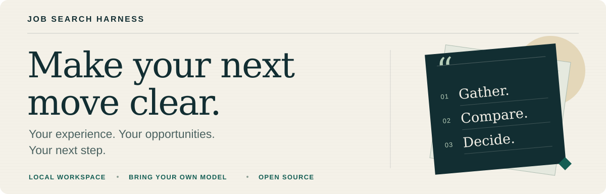

# Job Search Harness

**Your next move, in one place.**

You've saved the role, tailored the résumé and heard back from a recruiter. Now: which job actually fits your experience, what did you send, and who needs a reply?

Job Search Harness keeps that context together on your computer: **your experience, the job description, the application and the next decision.** Upload a résumé, review the evidence, compare stated pay and pick up the conversation where you left off.

[Try the fictional demo](#quickstart) · [Let AI help you install](#ai-install) · [Choose your model](#models) · [中文](README.md)



*The current interface is in Chinese. [See actual product screenshots with fictional data →](docs/quick-tour.md)*

<a name="quickstart"></a>

## Try it before connecting an account

**No real résumé, mailbox or model account required.** The demo uses fictional records and simulated sending. Setup downloads the code and dependencies; running the demo does not contact recruiting accounts.

<details>
<summary><strong>macOS / Linux — clone, start, explore</strong></summary>

```sh
git clone https://github.com/milkrabbitt/job-search-harness.git
cd job-search-harness
./scripts/bootstrap.sh --demo --install-deps
./scripts/serve.sh
```

</details>

<details>
<summary><strong>Windows PowerShell — clone, start, explore</strong></summary>

```powershell
git clone https://github.com/milkrabbitt/job-search-harness.git
cd job-search-harness
.\scripts\bootstrap.ps1 -Demo -InstallTimezone -InstallDependencies
.\scripts\serve.ps1
```

</details>

Open the address printed in the terminal, usually **http://127.0.0.1:8876/**. Keep the process running; **Ctrl+C** stops it. Use a fresh directory for the demo and keep real data separate.

Requires Python 3.9+, SQLite 3.24+ and IANA timezone data. PDF extraction uses `pypdf`; the scripts can install the dependencies in a local virtual environment. [Full installation guide →](docs/install.en.md)

<a name="ai-install"></a>

### Prefer your coding assistant to do the setup?

[Copy the ready-to-use installation prompt →](docs/install.en.md#ai-install)

Give it to a terminal-capable assistant such as Codex, Claude Code or Cursor Agent. It can check the environment, install the project and verify the demo. Your installation assistant and your runtime model are separate choices; enter credentials locally, not in the conversation.

## See why a role fits your actual experience

Upload a **PDF up to 20 MB** on `/profile`, review the extracted text and confirm what is accurate. You can add your own experience summary and a separate introduction for recruiter replies. Approving a PDF for sending and confirming its text for matching are separate decisions.

With your **separate consent**, the selected model can compare bounded, redacted confirmed experience with the actual job description and selected preferences. Fit points must cite supplied evidence; gaps and unknowns remain visible. A changed profile, résumé, job or model requires a current review. Hard exclusions and sending authorization still apply.

Scanned, encrypted or unreadable PDFs require manual input or review. The original PDF stays local; the model consent applies to the processed text, which may still contain real work and project details. [How résumé matching works →](docs/candidate-guide.md)

## Put the pay figures next to each other

Select **2–6 saved roles** on `/salary`. See the original quote, currency, pay period, stated salary-payment count and source together.

Annual reference amounts are calculated **only when CNY, monthly pay and the salary-payment count are explicit**. For example, “CNY 20–30K/month, 13 payments” becomes CNY 260–390K/year. An unexplained “20–30K” stays unconfirmed. No guessed bonuses, currency conversion or complete offer-package valuation.


[See the calculation rules →](docs/compensation.md)

## Follow the conversation without losing the record

Keep application text, approved résumé versions, recruiter messages and available sending evidence together. An uncertain email result is reconciled before another send is considered.

With a **verified, send-ready NetEase 126 mailbox and your authorization**, Harness can handle eligible applications and narrow, fact-backed routine replies. A separate setting permits one configured follow-up. Interview arrangements, salary, start dates, offers and other important decisions go to you and pause automatic routine replies in that thread.


**Scanning is not permission to send.** Background tasks and outbound sending have separate controls. [Take the visual tour →](docs/quick-tour.md) *(Chinese)*

<a name="start"></a>

## Ready to use your own information?

Choose a private data directory outside the repository and initialize **without demo mode**. Open `/setup` to enter your goals, choose and test a model or select rules-only screening, register recruiting sources, and start. Then use `/profile` to confirm your experience and résumé.

- **Sources come from you.** Harness checks configured, supported public sources and authorized channels. Saving a URL checks its structure; the first scan establishes whether it can be read and parsed. No sources means no automatic job discovery.
- **Your process stays in view.** Tasks need the service running; closing a browser tab is fine, but sleep or shutdown pauses work. Outbound sending remains separately controlled.
- **Site actions retain a human step.** BOSS Zhipin, Liepin chat and Yupao submissions/replies happen in your logged-in browser. Harness stores the queue and verified records. Company application forms are also submitted on the original site.
- **Some channels are macOS-only.** NetEase 126 and authorized Liepin search currently use macOS Keychain. Windows/Linux support the core workspace and model integrations, not those full credential-backed channels.

[Private setup and résumé registration](docs/install.en.md#private-profile) · [Channel requirements](job_harness/CHANNELS.md) · [Pause, backup and recovery](docs/onboarding.md#maintenance)

<a name="models"></a>

## Use a model you already have access to

| Connection | Your choice |
| --- | --- |
| Cloud APIs | OpenAI, Anthropic, Gemini, DeepSeek, Qwen, Moonshot, Zhipu, MiniMax |
| Local model services | Ollama or LM Studio, already running with a model loaded |
| CLI | A locally authenticated, compatible Codex CLI |
| Other services | An OpenAI-compatible endpoint you configure |
| No model | Local rule-based screening |

These are **implemented adapters with simulated protocol tests**, not a claim that every provider, account, model and region has passed live testing. Supply an available model name and complete a connection test on your computer. Chat subscriptions do not automatically include API credits. [Provider setup and limits →](docs/models.md)

## Your data, with explicit boundaries

Experience-to-JD matching sends processed experience and job text only with its separate consent. Redaction reduces common identifiers; it does not make career history anonymous. A local workspace does not make a cloud model local.

Model keys come from environment variables or **unencrypted private local files**. Keep data and keys out of Git. Database backups exclude model keys and original PDF files. Set daily call and timeout limits; HTTP APIs also have an output cap. Exact monetary accounting is not implemented—a nonempty currency budget blocks calls rather than pretending to enforce a bill limit.

[Data and model details](docs/models.md) · [Troubleshooting](docs/troubleshooting.md)

<a name="tests"></a>

## Built to be inspected and improved

```sh
.venv/bin/python -B -m unittest discover -s tests -v
```

This uses the default installation environment. On Windows, use `.\.venv\Scripts\python.exe -B -m unittest discover -s tests -v`; for a custom environment, use its Python.

Tests cover core workflows, model protocols, configuration boundaries and simulated sending. Check actual platform results in [GitHub Actions](https://github.com/milkrabbitt/job-search-harness/actions/workflows/tests.yml). Real provider accounts, mail delivery and site login still need verification in your own environment.

**Want better tools on the applicant's side? Give it a Star.** Try the demo, then tell us which part of your search needs less busywork.

[Report an issue](https://github.com/milkrabbitt/job-search-harness/issues) with fictional data, improve the docs or contribute code. [MIT licensed](LICENSE).
