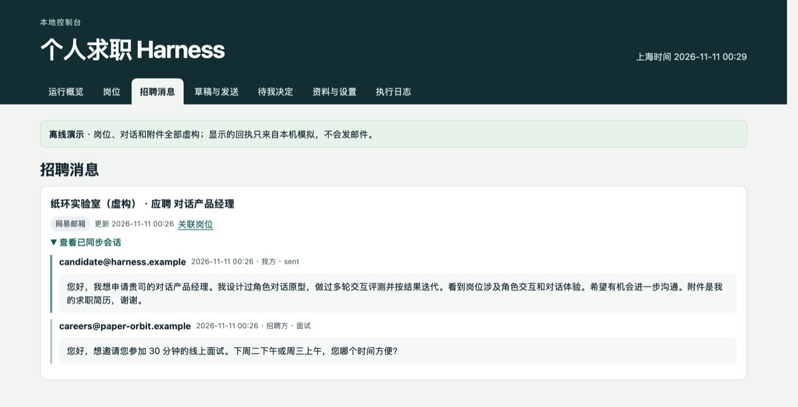

# Job Search Harness

A job-search workspace that runs on your computer. Set your goals, model and recruiting sources, then keep job evidence, application materials, recruiter messages and next actions together. Background tasks and outbound sending have separate controls. The console is currently in Chinese.

[First setup](#start) · [Offline demo](#quickstart) · [AI installation prompt](docs/install.en.md#ai-install) · [中文](README.md) · [Releases](https://github.com/milkrabbitt/job-search-harness/releases)

## How it works

1. **Set your goals.** The first-run `/setup` wizard asks for role direction, cities, salary floor and exclusions. An empty installation does not infer your personal goals.
2. **Connect a model you can use.** Choose a locally authenticated Codex CLI, a cloud API or a running local model service, then test the exact model and endpoint. You can also start with rules only. Chat subscriptions and API access are different products; see [model setup](docs/models.md).
3. **Register sources and start.** Add public recruiting sources you are allowed to read. After validation, start scanning configured sources and reviewing matches. No configured sources means no automatic job discovery; this is not unrestricted autonomous web search.
4. **Keep a verifiable application record.** Enter a self-confirmed summary and optionally register a local PDF path in setup. Harness keeps a private copy and fingerprint; editing JSON is not required. Review the recipient, body and attachment before enabling real outbound sending. Uncertain email results require reconciliation before retrying.
5. **Continue the conversation.** Review synced or recorded threads with their jobs. Interview times, salary, availability and offers remain your decisions. Automatic replies cover only narrow, preauthorized requests supported by the channel.



*Actual console screenshot. All demo jobs, messages and receipts are fictional or simulated.*

<a name="start"></a>

## Install and open setup

Requires Python 3.9+, SQLite 3.24+ and IANA timezone data. PDF text extraction uses pypdf; no Node.js build is needed.

**macOS / Linux**

```sh
git clone https://github.com/milkrabbitt/job-search-harness.git
cd job-search-harness
./scripts/doctor.sh
./scripts/bootstrap.sh --install-deps
./scripts/serve.sh
```

**Windows PowerShell**

```powershell
git clone https://github.com/milkrabbitt/job-search-harness.git
cd job-search-harness
.\scripts\bootstrap.ps1 -InstallTimezone -InstallDependencies
.\scripts\doctor.ps1
.\scripts\serve.ps1
```

On Windows, `-InstallTimezone` installs timezone data in the selected Python environment.

Open the address shown in the terminal, normally `http://127.0.0.1:8876/setup`. Complete **goals → model → sources → tests → start**. A cloud connection test may incur API charges. Setup needs your actual goals, credentials and sources; an installation assistant cannot invent them.

Keep the process running. Closing the browser does not stop it; press **Ctrl+C** in the terminal to stop. Sleep and shutdown pause work.

[Full installation guide](docs/install.en.md) · [First-run and daily use](docs/onboarding.md) · [Channel requirements](job_harness/CHANNELS.md)

<a name="quickstart"></a>

## Try the offline demo

The demo needs no real résumé, mailbox or model account. Use a separate directory from real data.

macOS / Linux:

```sh
./scripts/bootstrap.sh --demo --install-deps
./scripts/serve.sh
```

Windows PowerShell:

```powershell
.\scripts\bootstrap.ps1 -Demo -InstallDependencies
.\scripts\serve.ps1
```

The default data directory is `.job-harness-dev/`. For real use, set the same `JOB_HARNESS_DATA_DIR` outside the repository when initializing and starting the service.

## What is supported

| Integration | Current scope |
| --- | --- |
| Codex CLI | Uses a locally authenticated CLI and an available model to review match features. CLI parameter compatibility is required. |
| OpenAI, Anthropic, Gemini, DeepSeek, Qwen, Moonshot, Zhipu, MiniMax | API adapters are implemented. Supply your own available model name, account access and regional endpoint. |
| Ollama, LM Studio | Connect to a local service you have started with a model loaded. Harness does not download models for you. |
| OpenAI-compatible | A compatible API adapter; not a claim that every third-party service has been live-tested. |
| Company websites | Read registered and accessible public recruiting sources. Submit application forms on the original site. |
| NetEase 126 and authorized Liepin search | Credential integration currently requires **macOS Keychain**. Windows/Linux core support does not enable these full channels. |
| BOSS Zhipin, Liepin chat, Yupao | Queue actions, check duplicates and retain evidence. A human completes site actions in a logged-in browser. |

Adapters are implemented and covered by simulated protocol tests. Those tests do not establish live access to every provider, model or region. Complete a connection test using your own account before enabling an integration. See the [provider matrix](docs/models.md).

New users default to general screening based on their own role keywords, cities, salary floor and exclusions. The older AI application, product, robotics and financial-product preset remains an optional compatibility mode. Model review is advisory, not an acceptance probability or complete skill assessment. Unlisted salary stays unknown; full offer-package comparison is not implemented. Register a summary and PDF through setup, or import multiple facts and versions through a [private profile file](examples/profile.example.json). Upload a PDF on `/profile`, review extracted text and explicitly confirm it before matching. Scanned or encrypted files require manual review.

## Before using real data

- **Control calls, not an assumed bill.** Set a daily call limit and timeout. HTTP APIs also have an output-token cap; that field does not cap Codex CLI output. Reliable dollar accounting is not implemented; a nonempty currency budget blocks calls rather than pretending to enforce a price limit.
- **Local files are not encrypted.** Model keys can come from environment variables or the data directory's `private/model-keys/`. POSIX permissions are restricted; Windows relies on your user directory's access controls. Never share or commit these files.
- **Cloud review sends limited match features to the provider.** A local console does not imply local inference. Verify the backend of your local model service too.
- **Database backups exclude model keys.** Reconfigure credentials and test after restoring. Keep original résumé files separately. Retest after changing model, endpoint or key.
- **Starting scans does not authorize sending.** Outbound messages still require their own controls, verified materials and channel authorization.

[Pause, reconfigure, back up and uninstall](docs/onboarding.md#maintenance) · [Troubleshooting](docs/troubleshooting.md)

<a name="ai-install"></a>

## Let your coding assistant install it

Give the [installation prompt](docs/install.en.md#ai-install) to a terminal-capable assistant such as Codex, Claude Code or Cursor Agent. Installation and runtime model choice are separate. Enter secrets locally, never in the conversation.

<a name="tests"></a>

## Verification and feedback

```sh
python3 -B -m unittest discover -s tests -v
```

Automation covers core workflows, model protocols, configuration boundaries and simulated sending. Check actual cross-platform results in [GitHub Actions](https://github.com/milkrabbitt/job-search-harness/actions/workflows/tests.yml). Live provider accounts, mail delivery and website login require verification in the user's own environment.

[MIT licensed](LICENSE). [Report issues](https://github.com/milkrabbitt/job-search-harness/issues) using fictional data; do not upload résumés, recruiting messages, secret configuration or private logs.


## Résumé upload, experience matching and pay comparison

On `/profile`, upload a PDF (up to 20 MB), review its extracted text and confirm it. Provide a confirmed experience summary and, optionally, a short introduction for outbound messages. Keep your desired roles, cities and pay preferences in `/setup`. PDF bytes stay in private local storage. Scanned, encrypted or unreadable documents are marked for manual input.

Experience-to-JD model matching requires a separate consent checkbox. The configured model receives bounded, redacted confirmed experience, actual JD text and selected preferences. Each fit point must reference supplied evidence. A changed résumé, profile or model invalidates its prior review; hard exclusions and sending authorization remain in application code.

Authorized and ready NetEase 126 can send approved applications, routine fact-backed replies and one configured follow-up. Interview scheduling, pay, start dates and offers enter the decision queue and pause automatic replies in that thread. Recruiting sites without supported sending APIs still use browser handoff.

On `/salary`, select 2–6 roles to compare original pay, currency, period, salary months and any annualized range that can be calculated from explicit terms. Unknowns stay pending confirmation; no currency conversion or estimated bonuses are added. See [salary details](docs/compensation.md).


