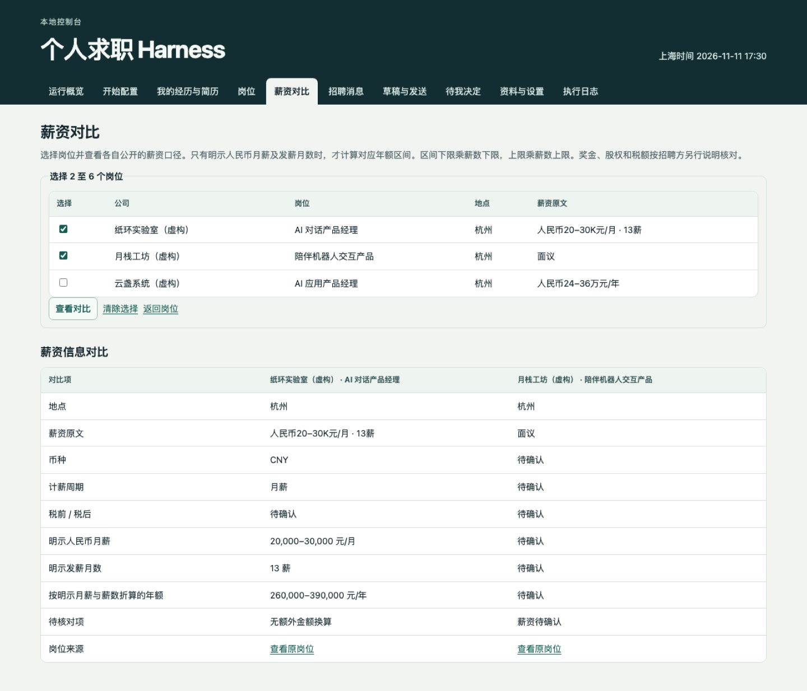

# Job Search Harness

一个在自己电脑上运行的求职工作台。填好求职条件、模型和招聘来源后，它按设置检查岗位、记录匹配依据，把申请材料、招聘回复和下一步待办放在一起。你可以暂停任务，也可以单独暂停外发。

[首次配置](#start) · [离线演示](#quickstart) · [让编程助手帮我安装](docs/install.md#ai-install) · [English](README.en.md) · [版本发布](https://github.com/milkrabbitt/job-search-harness/releases)

## 实际用起来是什么样

1. **先填自己的条件。** 首次打开进入 `/setup`：岗位方向、城市、最低薪资和排除项都由你填写，空安装不会猜测你的目标。
2. **接上自己能用的模型。** 选择 Codex CLI、云端 API 或本机模型服务，填写实际可用的模型名，完成连接测试。聊天会员、API 余额和本机模型是不同的接入方式，详见[模型说明](docs/models.md)。也可以先用不调用模型的规则流程。
3. **告诉它去哪里找。** 登记允许读取的公开招聘来源，再测试和启动。启动后会检查已配置的来源，并按设置筛选和复核；没有来源就没有自动发现的岗位，不会凭空在全网找工作。
4. **上传简历，用实际经历筛岗位。** 在「我的经历与简历」选择 PDF，核对提取的文字，再补充自己的贡献和对外简介。勾选模型匹配授权后，工作台会把裁剪、遮蔽联系方式后的经历和实际 JD 交给你选择的模型，列出有关联的经历、缺口和待核实项，并保留来源引用。修改经历或更换模型后会重新复核。
5. **授权渠道后继续跟进。** 网易 126 接通且核验可发送后，可在页面授权申请、常规回复和一次未回复跟进。对方明确索要已批准的简历、作品或问到有依据的简单问题时，按规则处理；每次发出的正文、附件、回复和凭据都留在记录里。收到面试邀约或条件协商，会交到「待我决定」，等待你确认。
6. **把几个岗位放在一起看薪资。** 「薪资对比」可选 2–6 个岗位，对照原报价、币种、计薪周期和明示薪数。只有口径明确时才折算年额；没有公开或无法确认的部分显示「待确认」。



*真实产品截图，岗位、邮件和邀请均为虚构演示数据。*

<a name="start"></a>

## 安装后，打开向导开始配置

需要 Python 3.9+、SQLite 3.24+ 和 IANA 时区数据。控制台目前为中文；PDF 文字提取使用 pypdf；无需 Node.js 构建。

**macOS / Linux**

```sh
git clone https://github.com/milkrabbitt/job-search-harness.git
cd job-search-harness
./scripts/doctor.sh
./scripts/bootstrap.sh --install-deps
./scripts/serve.sh
```

**Windows PowerShell**

```powershell
git clone https://github.com/milkrabbitt/job-search-harness.git
cd job-search-harness
.\scripts\bootstrap.ps1 -InstallTimezone -InstallDependencies
.\scripts\doctor.ps1
.\scripts\serve.ps1
```

Windows 的 `-InstallTimezone` 会在选定 Python 环境安装时区数据包。

打开终端显示的地址，默认为 `http://127.0.0.1:8876/setup`。按顺序完成 **求职条件 → 模型 → 招聘来源 → 测试 → 开始工作**。设置通过检查后才开始真实任务；模型测试会调用你配置的服务，云端 API 可能计费。

第一次配置需要你提供真实目标、可用账号和招聘来源。安装助手能帮你操作，但不能替你产生这些信息。终端需保持运行；关网页不等于停服务，按 **Ctrl+C** 停止，电脑休眠或关机会暂停任务。

[完整安装与私有资料登记](docs/install.md) · [向导与日常使用](docs/onboarding.md) · [渠道接入](job_harness/CHANNELS.md)

<a name="quickstart"></a>

## 先体验离线演示

演示使用虚构资料和模拟发送，无需真实简历、邮箱或模型账号。请在新目录或独立数据目录中运行，避免与真实资料混用。

macOS / Linux：

```sh
./scripts/bootstrap.sh --demo --install-deps
./scripts/serve.sh
```

Windows PowerShell：

```powershell
.\scripts\bootstrap.ps1 -Demo -InstallDependencies
.\scripts\serve.ps1
```

打开终端显示的本机地址。默认数据目录是 `.job-harness-dev/`；真实资料建议放在仓库外，并为初始化和启动设置相同的 `JOB_HARNESS_DATA_DIR`。

## 哪些接入已实现

| 接入 | 当前能力与边界 |
| --- | --- |
| Codex CLI | 使用本机已经认证的 CLI 复核匹配信息。需要与调用参数兼容的 CLI 和实际可用的模型。 |
| OpenAI、Anthropic、Gemini、DeepSeek、Qwen、Moonshot、Zhipu、MiniMax | 提供 API 适配；模型名、账号权限和地区端点以用户自己的服务为准。 |
| Ollama、LM Studio | 连接用户已启动、已加载模型的本机服务；安装工作台不会自动下载模型。 |
| OpenAI-compatible | 连接兼容的接口，不代表所有声称兼容的服务均通过实测。 |
| 公司官网 | 检查已登记且可访问的公开招聘来源；官网表单仍在原站提交。 |
| 网易 126、猎聘授权搜索 | 当前凭据接入依赖 **macOS 钥匙串**；Windows / Linux 不因此获得这些渠道的完整能力。 |
| BOSS 直聘、猎聘站内聊天、鱼泡 | 登记待办、查重、保存回执；站内动作由操作者在已登录浏览器完成。 |

模型适配已实现并接受模拟协议测试；这些测试不等于每一家供应商的真实账号、模型和地区端点均已调用成功。请在自己的电脑上通过连接测试后启用。[完整模型矩阵](docs/models.md)

新用户默认按自己填写的岗位关键词、城市、薪资与排除项筛选；旧版 AI 应用预设仍可选。确认的经历可供本机规则比较；只有你同意后，才用于模型匹配。模型结论需引用给定经历和 JD，不能取消硬性排除或自行授权外发。PDF 原件保持不变，扫描件、加密件和无法提取的内容明确留待手动核对。[简历与匹配说明](docs/candidate-guide.md) · [薪资口径说明](docs/compensation.md)

## 使用前容易遗漏的事

- **API 费用。** 设置每日调用次数和超时；HTTP API 另有输出 token 上限，Codex CLI 不受该输出字段控制。金额预算目前没有可靠的实时计价，非空金额预算会阻止调用，不能当成美元账单控制器。
- **本地保存不等于加密。** API Key 可从环境变量读取，或保存在私有数据目录的 `private/model-keys/`。本地文件不加密；POSIX 使用私有文件权限，Windows 依赖当前用户目录权限。不要共享数据目录或提交到 Git。
- **经历匹配有单独的模型同意开关。** 勾选后，所选模型会接收经过遮蔽和裁剪的确认经历、JD 与求职偏好；未勾选只做本机比较。 本机运行控制台不等于本地推理。使用本机 Ollama / LM Studio 服务时，也应自行确认服务的实际后端。
- **备份不包含模型密钥。** 数据库恢复后需重新提供凭据并测试连接；简历原文件也要单独保管。换模型、端点或凭据后重新测试。
- **任务与外发分开。** 启动扫描不会自动授权发送申请。真实外发仍受独立开关、资料核验和渠道授权约束。

[备份、暂停、重配和卸载](docs/onboarding.md#maintenance) · [故障排查](docs/troubleshooting.md)

<a name="ai-install"></a>

## 让编程助手帮我安装

把[安装提示词](docs/install.md#ai-install)交给有终端操作能力的 Codex、Claude Code 或 Cursor Agent。它负责检查环境和完成安装；运行时模型可另选。密钥由你在本机输入，不要贴进对话。

<a name="tests"></a>

## 验证与反馈

```sh
python3 -B -m unittest discover -s tests -v
```

自动化覆盖核心流程、模型协议、配置边界和模拟发送；跨系统结果以 [GitHub Actions](https://github.com/milkrabbitt/job-search-harness/actions/workflows/tests.yml) 为准。真实供应商账号、邮件收发及平台登录需要在使用者自己的环境验证。

采用 [MIT 许可证](LICENSE)。欢迎[反馈使用体验](https://github.com/milkrabbitt/job-search-harness/issues)，请用虚构资料复现问题，不上传简历、邮件、配置密钥或私人日志。
