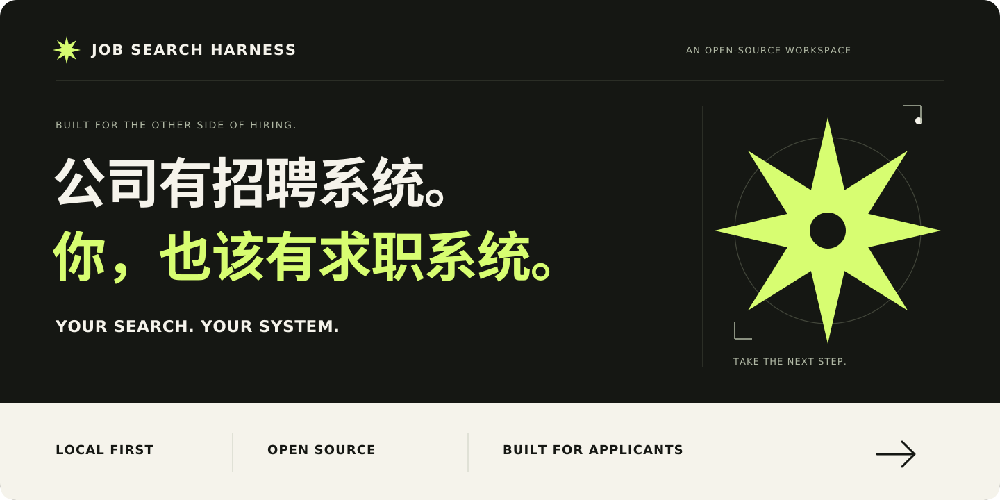
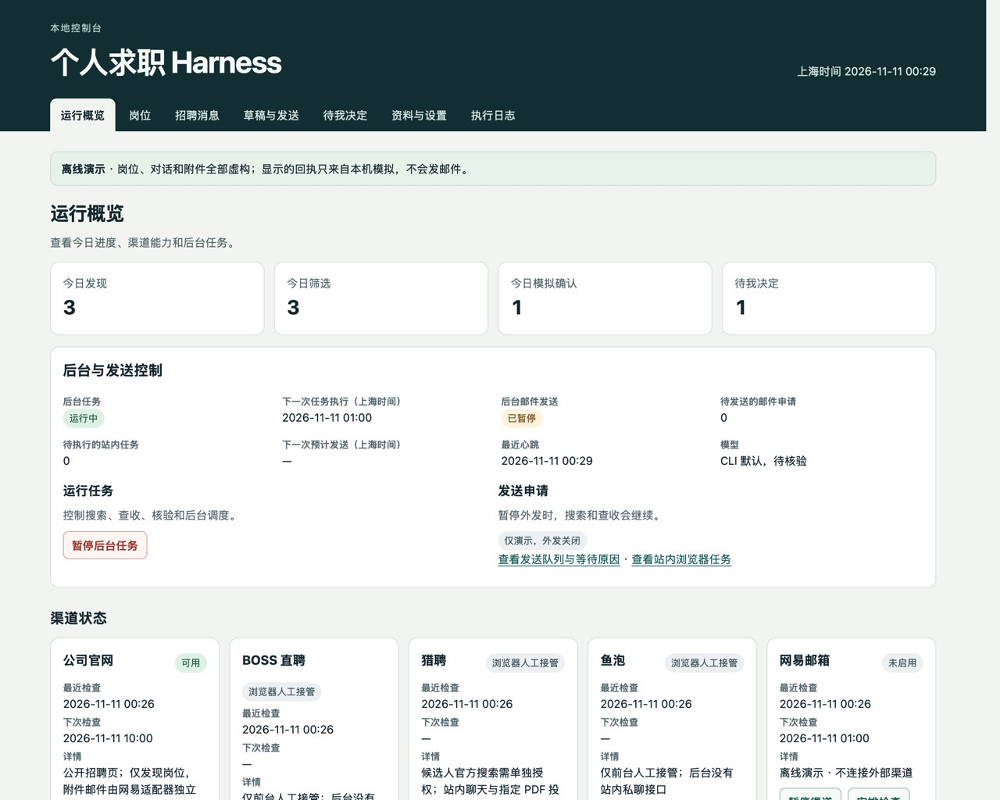
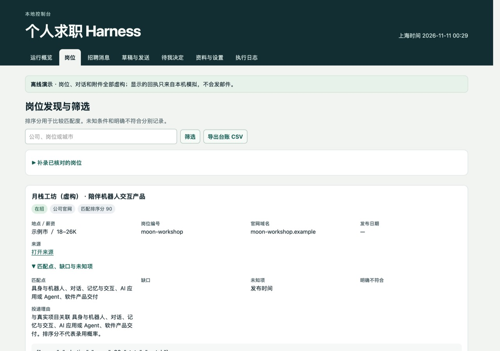
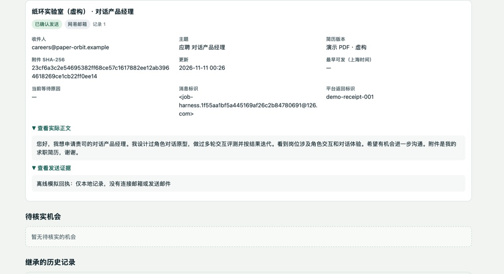
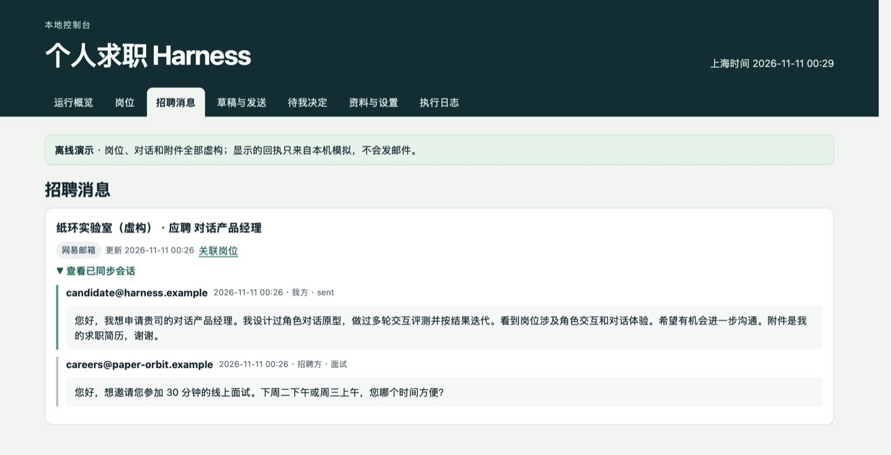

<p align="center">
  
</p>

<h1 align="center">你的下一份工作，值得一套更好的工具。</h1>

<p align="center">一个属于你自己的 AI 求职工作台，把岗位整理、申请准备和进度跟进串成完整流程。</p>

<p align="center"><strong>少一点复制粘贴，少一点遗漏，多一点有准备的机会。</strong></p>

<p align="center">
  <a href="#quickstart">立即体验</a> ·
  <a href="#ai-install">让 AI 帮我安装</a> ·
  <a href="README.md">中文</a> / <a href="README.en.md">English</a> ·
  <a href="LICENSE">MIT</a> ·
  <a href="#tests">测试</a> ·
  <a href="https://github.com/milkrabbitt/job-search-harness/releases/tag/v0.1.0">v0.1.0 beta</a>
</p>

- **看清为什么值得投。** 根据你的求职条件解释匹配点、明确缺口和待核实项。
- **把申请送到正确的位置。** 核对收件人和简历版本，查看草稿、发送状态和核验凭据。
- **让招聘消息有下一步。** 查看会话上下文，把面试时间、薪资和 Offer 等需要判断的事项留给你。



*实际产品截图。演示中的公司、岗位、申请和消息均为虚构，发送结果由模拟渠道产生。*

收藏了很多岗位，却忘了哪些投过？每次申请都重新复制粘贴，聊过的机会还散落在不同地方？Job Search Harness 把这些零散步骤组织起来，让每次求职都有记录、有下一步。

<a name="ai-install"></a>

## 让 AI 帮我安装

复制下面这段，交给 Codex、Claude Code 或 Cursor Agent。你用来安装项目的编程助手，和项目运行时可选的模型，是两个独立角色。体验演示只需要本机 Python。运行时模型复核岗位时，使用已由你在本机登录的 Codex CLI。

```text
请在我的电脑上安装并验证 Job Search Harness。
仓库 https://github.com/milkrabbitt/job-search-harness

1. 克隆到一个新目录，阅读 README 和 job_harness/CHANNELS.md。
2. 运行 ./scripts/doctor.sh，检查 Python、SQLite、时区数据和可用端口。用 python3 -m venv .venv 创建隔离环境，把 PYTHON_BIN 指向 .venv/bin/python。按 requirements.txt 核对依赖，仅在缺少时区数据时按文档安装。
3. 运行 ./scripts/bootstrap.sh --demo，再用 ./scripts/serve.sh 启动演示，打开它显示的本机地址。先用虚构数据检查岗位匹配、申请草稿和模拟发送证据、招聘消息与待决定事项。
4. 用 .venv/bin/python -B -m unittest discover -s tests -v 运行测试。演示和测试期间保持真实账号与外发关闭。
5. 如果我希望使用运行时模型，检查本机是否已有经我本人登录的 Codex CLI。向我说明这一步是可选的。等我本机完成认证后，在独立的非演示数据目录中将 config.json 的 model.enabled 设为 true，必要时设置 model.executable，重启该实例。然后在控制台“资料与设置”配置实际可用的模型、调用上限与超时，并安排模型检查。
6. 把实际验证结果、本机地址、数据目录、启动与停止方法告诉我。不要读取或复用已有求职数据。密钥与授权码由我在本机的系统凭据管理器或官方登录流程中配置，禁止粘贴到聊天、写入代码或提交到 Git。
```

<a name="quickstart"></a>

## 立即体验

需要 macOS 或 Linux、Python 3.9+、SQLite 3.24+ 和包含 `Asia/Shanghai` 的 IANA 时区数据。界面当前为中文。默认运行只使用 Python 标准库。

```sh
git clone https://github.com/milkrabbitt/job-search-harness.git
cd job-search-harness
./scripts/doctor.sh
./scripts/bootstrap.sh --demo
./scripts/serve.sh
```

打开 [本地控制台](http://127.0.0.1:8876/)。服务运行在当前终端，关掉网页后仍在运行，在终端按 **Ctrl+C** 停止。默认数据放在仓库下独立的 `.job-harness-dev/`。要切换数据目录，给初始化和启动脚本设置同一个 `JOB_HARNESS_DATA_DIR`。遇到端口冲突或缺少依赖，可看 [故障排查](#troubleshooting)。

## 三个你可以亲手走一遍的场景

### 收藏了一条岗位，想知道值不值得投

在「岗位」查看演示 JD，或补录一份你核实过的岗位和求职偏好。工作台把匹配理由、明确不满足的条件和招聘方没有说明的条件分别保存。回看时有原链接和判断依据，排序分只用于比较机会。



### 申请写好了，想确认附件和去向

打开「草稿与发送」，核对岗位、收件人、正文和简历。演示数据可用来查看申请的模拟结果与凭据。实际启用邮箱后，遇到发送结果不明的申请，工作台保留待核验状态，按邮件 Message-ID 查证，避免盲目重发。站内申请则由你在原平台提交，核实后登记回执。



### 收到面试邀约，需要自己挑时间

在「招聘消息」打开演示会话，再到「待我决定」查看需要确认的安排。原消息、关联岗位和处理进度留在同一工作台。能否赴约、接受什么条件，由你决定。



## 从演示切换到自己的资料

给真实资料选一个独立、私有的数据目录，初始化时省略 `--demo`。在「资料与设置」填写偏好，添加经过核实的公开招聘来源，并管理个人事实和已批准的简历版本。配置和导入格式见 [账号配置示例](examples/config.example.json) 与 [虚构资料示例](examples/profile.example.json)。

自动匹配预设目前聚焦中文 JD 的 AI 应用、产品、机器人与金融产品；可设置城市、方向词、薪资、排除项和外发规则。坐班备注与工作类型供人工参考。其他行业仍可补录和跟进。

| 渠道 | 当前能力 |
| --- | --- |
| 公司官网 | 读取已登记且可访问的公开招聘来源。官网申请表由你在原站提交。 |
| 网易 126 邮箱 | 配置 macOS 钥匙串后，可检查招聘邮件、准备线程回复，并按授权发送、核验邮件。 |
| 猎聘 | 配置候选人授权后，可搜索职位并补查公开详情。站内聊天与提交走浏览器接管。 |
| BOSS 直聘、鱼泡 | 在工作台登记待办、检查重复并记录回执。由你在已登录的浏览器完成站内动作。 |
| 可选模型 | 由本机 Codex CLI 复核有限的匹配特征。排序规则、授权和发送决定由工作台处理。 |

渠道开通、系统要求和故障处理见 [渠道与依赖说明](job_harness/CHANNELS.md)。通过外部账号发送会向收件方传送你的材料。真实外发应在核对资料、授权和账号后启用。

<a name="troubleshooting"></a>

## 故障排查

[完整诊断、后台管理与备份恢复说明](docs/troubleshooting.md)。

- **端口已占用。** 如果该端口上已经运行了同一个实例，直接打开控制台。要启动另一个实例，请使用独立的数据目录，并在该目录的 `config.json` 中设置空闲端口。
- **时区数据缺失。** 安装系统的 `tzdata`，或在所用的 Python 虚拟环境中运行 `python -m pip install tzdata`。
- **渠道未授权或访问受限。** 在「运行概览」查看渠道状态与错误。需要登录或验证时，在原网站完成，再按 [渠道与依赖说明](job_harness/CHANNELS.md) 检查本机配置。

## 运行、隐私与备份

- **本机运行。** 控制台仅监听回环地址。macOS 可以用项目的 `install` 子命令安装当前用户的 LaunchAgent，用 `start`、`status`、`stop` 管理。Linux 可运行前台服务。电脑休眠或关机时后台任务也会暂停。
- **运行任务和外发分别控制。** 在「运行概览」暂停全部外发时，搜索与查收可继续。暂停后台任务会停掉调度。
- **真实资料由你保管。** SQLite 数据、简历与备份请放在源码目录之外。系统钥匙串保存真实渠道凭据。项目不会自动带入其他安装实例的数据。
- **备份和恢复。** 在控制台创建备份，或运行 `python3 -B -m job_harness --data-dir "$JOB_HARNESS_DATA_DIR" backup`。停止该实例后，使用同一数据目录运行 `restore /path/to/backup.sqlite3`。恢复后先核对发送记录，再恢复外发。

<a name="tests"></a>

## 测试

本地测试使用临时数据库、虚构数据和模拟渠道。它覆盖匹配、查重、草稿失效、附件校验、暂停、发送结果核验与恢复。

```sh
python3 -B -m unittest discover -s tests -v
```

如果它让你的求职少了一点混乱，欢迎点个 Star。也欢迎提问题、分享使用体验，或一起完善下一个功能。请先用虚构数据复现问题，再 [提交 Issue](https://github.com/milkrabbitt/job-search-harness/issues)。

按 [MIT 许可证](LICENSE) 开源。
