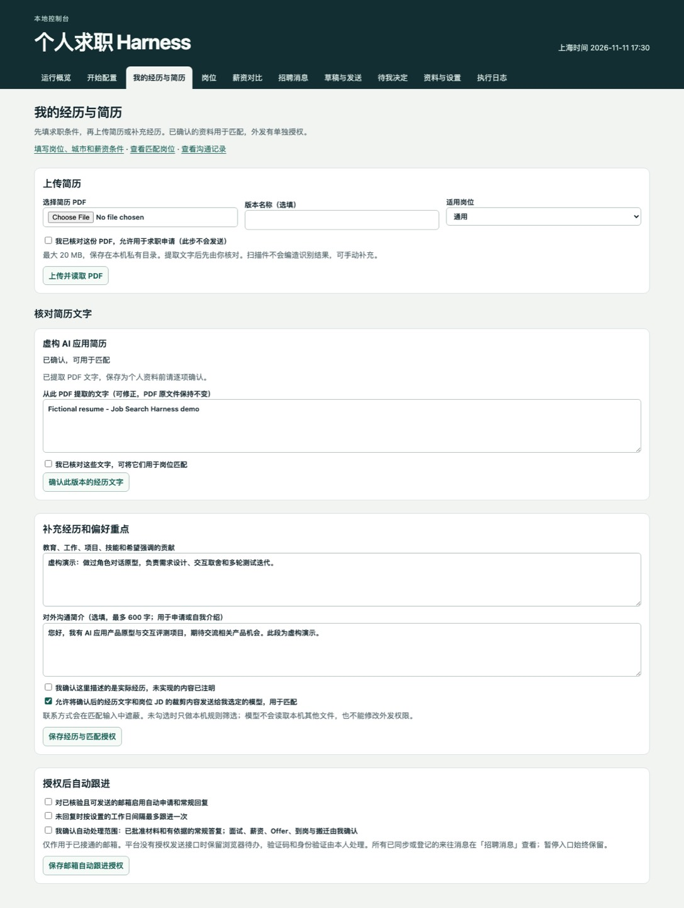
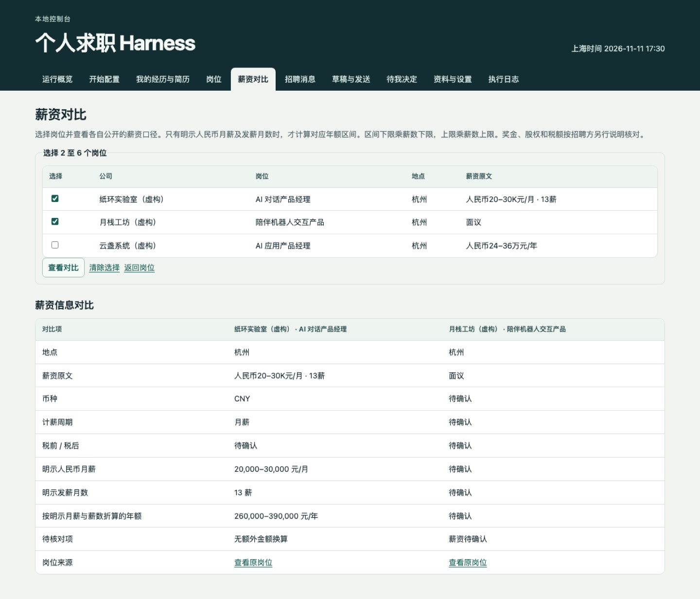
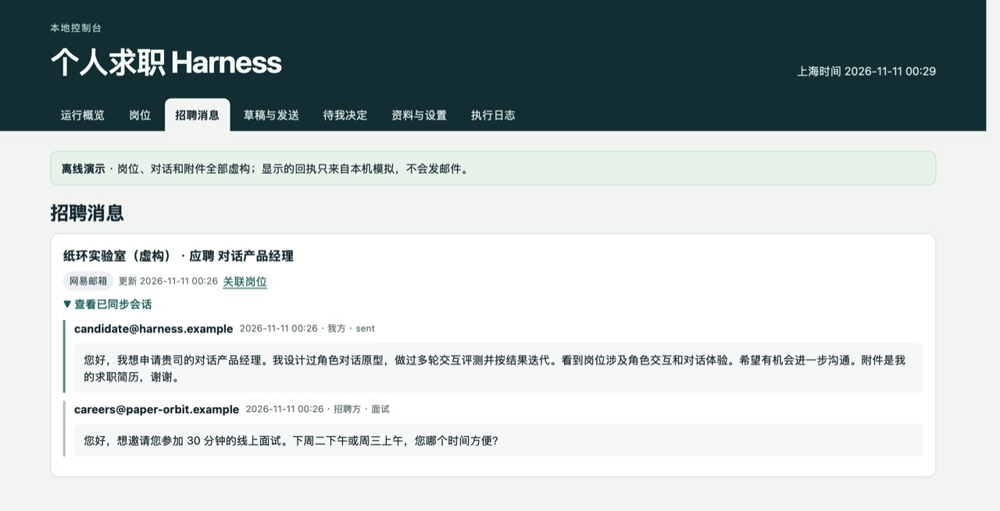

# 先看效果：从「这个岗位怎么样」到「下一步做什么」

[返回首页](../README.md) · [复制安装提示词](install.md#ai-install) · [跑离线演示](../README.md#quickstart)

不安装也能先看懂。下面都是实际软件界面截图，来自离线演示或浏览器测试；简历、公司、岗位和消息均为虚构，回执为模拟结果。

## 01 · 把经历交给它，把核对权留给你

上传简历 PDF，先看提取结果，再确认哪些是自己的实际经历。补充自己做过的项目、具体贡献和对外简介后，可以授权所选模型将这些内容与实际 JD 对照，列出相关经历、缺口和待核实项，并附来源引用。

**值得看的细节：** 修改提取文字不会改动原 PDF；上传附件、确认经历、允许模型匹配、允许邮箱发送分别控制。扫描件或提取失败会提示手动补充。

这张图展示的是简历与授权页面。模型匹配需要先配置可用模型并同意发送裁剪、遮蔽后的经历和 JD；这不是模型对候选人的录用保证。[查看具体步骤](candidate-guide.md)

## 02 · 几份工作，摊开看清楚

在「薪资对比」选择 2–6 个岗位。把原始报价、币种、计薪周期、明示薪数放到同一张表里，缺了什么也一眼能看到。

图中一份岗位写明「人民币 20–30K 元/月 · 13薪」，所以能计算出 **26–39 万元/年**；另一份只写「面议」，就保留「待确认」。税前税后没说，也不会自行补上。

这只是按原文明示条件计算的年额，奖金、股权、福利和税款仍需核实；外币不会自动换算。[查看薪资口径](compensation.md)

## 03 · 对方回了，知道下一步该谁处理

「招聘消息」把已同步或登记的来往记录放在对应岗位下：之前怎么介绍的、对方回复什么，都能回看。

图中是虚构的面试邀请。遇到面试、谈薪、Offer 等事项，系统交到「待我决定」；接通并授权的网易 126 可以按规则处理批准材料和常规问题。邮箱凭据目前使用 macOS 钥匙串。BOSS、猎聘、鱼泡站内操作由本人在已登录浏览器完成。

**下一步要做什么，比又多一份聊天记录更有用。** [了解渠道接入](../job_harness/CHANNELS.md)

## 现在就试试

- **想先点点看：** [运行虚构数据演示](../README.md#quickstart)，不需要模型 Key、真实简历或邮箱账号。
- **想交给编程助手装好：** [复制安装提示词](install.md#ai-install)，先验证演示，再配置自己的模型和来源。
- **想录一段自己的实际使用：** [打开真机录制提示词](video-demo-prompt.md)，在自己的电脑上录制软件和已授权的招聘沟通。

如果这正是你找工作时缺的一张工作台，欢迎给 [Job Search Harness](https://github.com/milkrabbitt/job-search-harness) 点个 Star，试用后把卡住的地方告诉我们。
