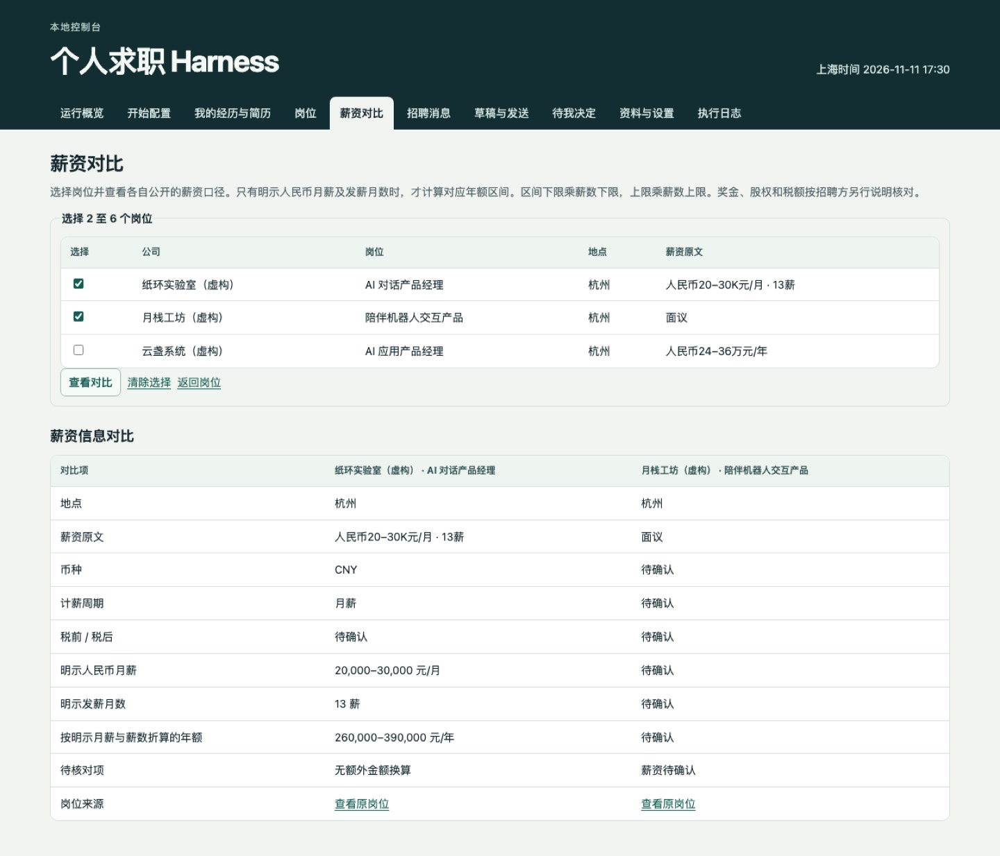

# v0.3.0 · 先看清匹配，再决定投递（预览版）

**你的经历，和这份工作到底哪里对得上？几份岗位的薪资差在哪？招聘方回了以后，下一步该做什么？**

Job Search Harness 把这些问题放进自己的求职工作台。这一版可以直接上传并核对简历，用实际经历对照 JD，再把薪资、招聘往来与待办放到一起看。

[**看实际界面 →**](https://github.com/milkrabbitt/job-search-harness/blob/main/docs/quick-tour.md) · [**让编程助手帮你安装 →**](https://github.com/milkrabbitt/job-search-harness/blob/main/docs/install.md#ai-install) · [支持的模型](https://github.com/milkrabbitt/job-search-harness/blob/main/docs/models.md)

## 这一版，先试这三件事

### 1. 匹配点要有依据，缺口也要看见

打开 `/setup` 配置目标与模型，再到「我的经历与简历」上传 PDF、核对提取文字并补充自己的贡献。授权后，所选模型对照这些经历和实际 JD，列出相关经历、缺口和待核实项，并引用所提供的内容。资料、岗位或模型变化后需要重新复核。

PDF 最大 20 MB，原件保留在本机。扫描件、加密件或无法可靠读取的内容留给本人补充确认。上传附件、确认文字、允许模型匹配与允许外发分别控制。

### 2. 几份工作，摊开看清楚

同时选择 **2–6 个岗位**，保留原始薪资文字，查看币种、计薪周期和明示薪数。明确写出人民币月薪与薪数时才折算年额；只写「面议」就保留「待确认」。



*实际软件截图，使用虚构岗位。年额按招聘方明示条件计算，不是到手收入、奖金预测或 Offer 保证。*

### 3. 跟进有记录，关键决定有入口

回看已同步或登记的申请、招聘消息与发送凭据。接通且核验可发送的网易 126 后，可以单独授权批准材料的发送、规则覆盖的常规回复和最多一次未回复跟进；收到面试、谈薪、到岗或 Offer 等事项，进入「待我决定」，相关会话的常规自动回复暂停。

网易 126 与猎聘授权搜索的凭据接入目前依赖 **macOS 钥匙串**。BOSS、猎聘和鱼泡站内投递及聊天仍由操作者在已登录浏览器完成。

## 先跑演示，不用真实账号

需要 Git、Python 3.9+、SQLite 3.24+ 和时区数据。以下从发布标签安装，便于复现本版本；安装依赖需要联网，演示使用虚构资料与模拟发送，不接真实招聘账号。

macOS / Linux：

```sh
git clone --branch v0.3.0 https://github.com/milkrabbitt/job-search-harness.git
cd job-search-harness
./scripts/bootstrap.sh --demo --install-deps
./scripts/serve.sh
```

Windows PowerShell：

```powershell
git clone --branch v0.3.0 https://github.com/milkrabbitt/job-search-harness.git
cd job-search-harness
.\scripts\bootstrap.ps1 -Demo -InstallTimezone -InstallDependencies
.\scripts\serve.ps1
```

打开终端显示的本机地址，通常为 **http://127.0.0.1:8876**。已有安装请另选新目录。正式使用前停止演示，按[安装说明](https://github.com/milkrabbitt/job-search-harness/blob/main/docs/install.md)设置独立私有目录，去掉演示参数，并完成 `/setup`。关机、休眠或停止服务后，后台任务会暂停。

## 模型自选，控制权保留

提供 Codex CLI，OpenAI、Anthropic、Gemini、DeepSeek、Qwen、Moonshot、Zhipu、MiniMax API，以及 Ollama、LM Studio 和 OpenAI-compatible 接入。准备自己可用的模型、凭据与端点，连接测试通过后启用。也可先用本机规则流程。

模型适配有模拟协议测试，不等于每个真实账号和地区端点都已验证。授权经历匹配后，裁剪与遮蔽后的经历和 JD 会发给所选模型；使用云端服务可能计费。原 PDF 留在本机，私有文件并未加密。

## 验证与开源

测试使用临时数据库、虚构 PDF、模拟模型与邮件回执。浏览器测试覆盖简历上传、文字确认、条件保存、薪资选择、面试交接与暂停恢复；另有重复发送、资料变更、错误附件和失败恢复回归测试。此版本未向真实招聘方发送测试消息。

[测试记录](https://github.com/milkrabbitt/job-search-harness/actions/workflows/tests.yml) · [简历与匹配说明](https://github.com/milkrabbitt/job-search-harness/blob/main/docs/candidate-guide.md) · [薪资口径](https://github.com/milkrabbitt/job-search-harness/blob/main/docs/compensation.md)

**想把求职进度理清楚，欢迎点一个 Star，先跑演示再反馈。** [返回仓库](https://github.com/milkrabbitt/job-search-harness) · [宣传文案](https://github.com/milkrabbitt/job-search-harness/blob/main/docs/launch/zh-CN.md) · [真机录制提示词](https://github.com/milkrabbitt/job-search-harness/blob/main/docs/video-demo-prompt.md)

## English

Know why a role fits before you apply. This preview adds reviewed PDF uploads, consent-based experience-to-JD matching with source references, explicit email follow-up authorization, and side-by-side pay comparisons for 2–6 roles. Unknown pay stays unknown; interview and employment decisions stay with you. Try the fictional-data demo before connecting an account. The current UI is in Chinese. [English overview and setup](https://github.com/milkrabbitt/job-search-harness/blob/main/README.en.md).
